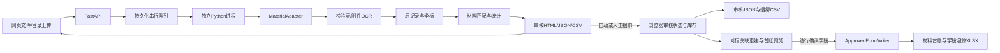

# 工程架构

逐阶段输入与输出见 [完整流程](WORKFLOW.md)，逐文件职责与修改入口见 [代码地图](CODE_MAP.md)，Git 边界见 [提交说明](GITHUB_SUBMISSION.md)。

浏览器通过FastAPI上传本地PDF。TaskService持久化任务、隔离同名文件，用单队列启动当前Python环境的子进程。workflow调用材料适配器完成提取、匹配、统计，复用原图审核页面。PDF之间不混用候选；Paddle单元格识别不在同一进程内并发。

cli负责稳定入口，workflow不判断钢筋字段。materials提供规则接口和实现；extraction/ocr提供图像/证据工具，延迟加载模型。当前表格提取仍以钢筋为基线，其他材料可以替换完整extract。matching/catalog保留历史五表/日期研发工具；网页用rebar/matching，日期排除。review为保存证据渲染器，其他材料可提供自己的审核页。web不要求钢筋规格字段。filling由材料适配器提供，钢筋已实现审核后台账预览与XLSX写入，其他材料仍可返回None。

钢筋提取通过 worker.py 顺序启动独立阶段：检验表进程退出后，附件每五页使用新 GPU 进程。附件每页写原子检查点，全部完成才合并 attachment_index.json。显存不足的阶段保留失败日志，batch 32 回退到 6，仅重试未完成页；stage_runs.json 和各页 performance 记录实际执行参数。Python 可捕获的显存错误与原生异常退出均保留进度。模型仍从同一缓存加载，进程初始化会增加开销。

网页任务进程拥有独立会话；服务关闭时停止整个任务进程组，避免留下占显存的阶段进程。原生崩溃可能未进入 finally，TaskService 用实际退出码补记状态；服务重启以持久任务状态补记仍标为 running 的执行记录。补记时间、来源和原始版本均保留。检查点用于当前任务内部重试，跨服务重启的续跑尚未实现。

每份文件状态queued→running→completed/failed/interrupted。部分成功的任务为partial_failed，成功文件仍可打开；重启未完成任务标中断，不静默重试或覆盖输出。缓存键包含PDF校验、材料配置、代码指纹、设备/profile和版式；原名一致且审核/summary存在才复制复用。改代码/配置后重启服务。

job.json记录上传及状态，executions在子进程启动前记录实际命令。子进程experiment记录配置、环境、输入校验、代码快照、起止及产物，失败work保留。这些运行记录由程序生成于本地任务目录，不依赖开发者的实验目录或研究脚本。

上传路径经过约束；只能读取指定任务产物或显式review-library。默认127.0.0.1，没有多用户账号体系。四表关联由review/associations.py生成初始自动捆绑，review_state.js负责人工确认、解除、库存扣减和导入导出；审核保存在浏览器缓存/下载，并在打开填表预览时以不可变快照备份到review_states/，原OCR不被改写。服务器按候选ID重建关联，filling/ledger.py校验字段确认和版本签名，钢筋Excel包含材料台账与字段溯源两张表。
