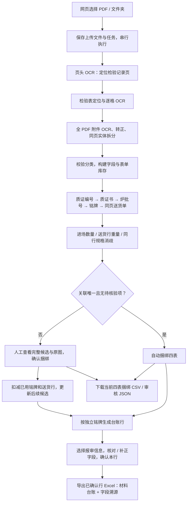

# 从 PDF 上传到审核和导出的完整流程

本说明对应当前钢筋实现。四表指「检验记录、质量证明书、铭牌、送货单」；报审表提供台账的使用部位等公共信息。钢梁、混凝土已有接入接口和配置示例，尚未启用实际识别与匹配。



CSV 用于四表关联清单；包含完整报审字段的材料台账当前导出为 XLSX。两者的字段与审核状态见下文。

## 1. 启动网页并上传

在项目根目录、已有 `ocr` 环境中运行：

```bash
conda activate ocr
python -m pip install -e .
python -m material_ocr serve --port 8080 --data-dir runs/web \
  --model-cache models/paddlex_cache --review-library runs
```

首次安装或依赖变化时才需执行安装命令。浏览器打开 `http://localhost:8080`，选择「钢筋」「自动选择支持的版式」，选择文件或文件夹，点击「开始识别与匹配」。Chrome / Edge 支持文件夹选择，目录及子目录中只处理 PDF。

人工审核保存在运行者自己的浏览器中。继续核验已确认结果时使用相同浏览器和地址；`localhost`、`127.0.0.1` 和不同端口拥有不同浏览器缓存。新接收方上传自己的样本，不会自动载入开发者的历史审核结果。

前端为 `web/static/`；上传接口为 `web/app.py` 的 `POST /api/jobs`。每批最多 100 份 PDF、单文件最多 256 MB、整批最多 1 GB。同名文件隔离保存，每个 PDF 独立匹配。

## 2. 创建任务、记录来源和执行配置

`web/tasks.py` 的 `TaskService` 保存上传文件、`job.json`、实际子进程命令和日志。单队列顺序执行文件，通过当前 Python 环境运行 `material_ocr analyze`，由 `workflow.py:run_pipeline()` 调用材料适配器。

缓存复用需文件 SHA256、材料、版式、设备、OCR profile、材料配置指纹与源码指纹一致，且同名文件已有完整结果。复用结果注明来源，不声称重新执行 OCR。任务运行记录保留输入哈希、配置、依赖版本、源码快照及实际状态。

页面刷新不会重新启动 OCR。停止或重启服务会将未完成任务标为中断，完成结果和失败证据保留；当前没有跨服务重启自动续跑。

## 3. 先定位并提取检验记录

`materials/rebar/adapter.py` 启动独立检验阶段进程；`worker.py` 调用 `extraction/batch.py` 扫描全 PDF 页头。`materials/rebar/routing.py` 结合标题、表头和位置，给出明确检验页、其他页或待复核页，保留方向与 OCR 重试证据。

自动版式下，检验页依次尝试六行、十一行几何模板；手动选择版式时仅尝试选中的模板。按检测到的真实表格边界裁剪单元格，执行 OCR、空白行判断和有限的行号重试。十一行表支持受约束的列宽变化，无法通过几何校验时保留失败原因。

输出：

- `work/inspection/page_index.json`：逐页路由、目标页与提取状态。
- `work/inspection/records_all_pages.json`：原始检验记录及记录 ID。
- `work/inspection/index.html`：检验页原图和提取诊断。

「未找到检验记录页」与「已找到但表格定位或提取失败」分别报告。必须先得到有效检验明细，才能继续四表匹配。

## 4. 全 PDF 附件 OCR 与表单分类

附件阶段扫描所有页面，包括检验阶段标为其他或待复核的页面。`ocr/attachments.py` 负责全页 OCR、方向校验、实体与重点字段裁剪；`ocr/layout.py` 拆分同页不同表单。结果保存原文、置信度、页码、区域、原 PDF 坐标和转正坐标。

默认使用 `gpu:0`、`batched_gpu`，附件识别 batch 为 32。检验阶段进程退出后，附件每五页启动一个新进程，顺序释放显存；每完成一页写检查点。附件遇到 OOM 时保留完成页，改 batch 6 重试剩余页，仍失败则明确终止并保留日志。

`materials/rebar/review.py` 结合标题、实体和字段证据再次校验分类。页面可同时包含铭牌与送货单，分类不是给每页强制指定一个唯一角色。明确送货单标题与混合实体优先，避免第九页一类混合页被误当成整页质证书。

输出：

- `work/attachments/attachment_index.json`：全 PDF OCR、区域与字段索引。
- `work/attachments/checkpoints/`：逐页识别检查点。
- `review-inputs/recognition_results.json`：匹配实际采用的页角色分类。
- `review-inputs/keyword_catalog.json`：用于检索的字段、原文与证据目录。

排错时依次检查「该页是否进入正确角色分类」「原图 OCR 是否完成」「所需编号是否进入字段目录」，可以区分分类错误、识别失败和编号提取失败。

## 5. 四表匹配、消歧和缺失补全

网页实际使用 `materials/rebar/matching.py`，规则按以下顺序组织：

1. 用检验记录的质证编号检索质量证明书。支持中文质编号标签及 `No.` / `No:` 等明确编号标签，保留不同 OCR 原文。
2. 从命中的质证书取炉批号，检索独立铭牌；炉批号与坐标用于区分同页不同物料。
3. 根据铭牌定位同页送货单；已定位送货单时，也可反向补同页铭牌。同页约束补关联页面，缺失的炉号、规格和重量仍需核验。
4. 多条路径共享炉批号时，用检验记录进场数量对送货单对应物理行重量筛选；重量识别不清晰时用同行规格辅助。清晰重量矛盾、规格冲突或剩余多解继续人工复核。
5. 编号未严格命中时优先补查未关联质证书，也保留铭牌炉批号反查证书的补查路径。缺字母、多点号、近似编号用于提示候选，不能据此静默改写原编号或自动确认。

人工库存以分类成功的全部表单为基础。即使某页编号或炉批号未提取，也进入候选清单；候选排序用于提高检索效率，不代替人工确认。当前网页匹配不使用日期规则。

`review/associations.py` 只对身份唯一且没有待核验项的四表自动捆绑；其余生成缺失原因、冲突和人工任务。完整的原始检验来源保留，重复内容共享捆绑组。

## 6. 人工确认四表、逐步缩小候选

完成任务后点击「查看匹配与审核」。审核页由 `review/render.py`、`review/templates/same_page.html`、`review_state.js` 和 `review_ui.js` 生成与维护。

1. 默认查看「待补全 / 待复核」；自动完成的关联在「已捆绑记录」中，不要求重复做匹配审核。
2. 查看质量证明书、铭牌、送货单三类候选清单，打开原图，核对编号、炉批号、规格和重量。
3. 选择对应候选，填写依据，点击「人工确认并捆绑四表」。后续候选扣除已使用的独立铭牌和送货行；同页不同炉号或送货行仍可独立使用。
4. 质量证明书覆盖多个物料时，经核验后允许共用。勾选查看已捆绑表单可检查完整库存；解除本组捆绑可将占用附件还回候选池。
5. 点击「下载捆绑与审核结果」保存 JSON；需要清单时点击「下载捆绑清单 CSV」。JSON 可在同 PDF 审核页通过「导入审核 JSON」恢复。

人工操作保存于浏览器 `localStorage`，按 PDF SHA256 区分。台账预览及状态同步还会将不可变备份写入 `review/review_states/`；页面不会自动从这些服务器备份恢复。迁移浏览器或机器时，用下载的审核 JSON 恢复。

原 `match_results.json`、`match_results.csv` 和 OCR 证据是生成时快照，不被人工操作覆盖。当前已捆绑数量以浏览器审核状态和下载的最新审核结果为准。

## 7. 生成台账并核验字段

四表关联确认后，`materials/rebar/filling.py` 提供字段来源，`filling/ledger.py` 根据可信候选 ID 重建关联并生成台账；一个独立铭牌对应一行，重复检验记录仅保留为来源引用。

|台账字段|主要来源|要求|
|---|---|---|
|材料名称|选中的报审表|必填|
|规格品种，如 `HRB400E/Ф10`|选中铭牌的牌号＋规格；缺失时用关联送货行规格补充|必填|
|生产单位|铭牌|必填|
|供应单位|关联送货单|必填|
|供货日期|报审表|必填，日期格式校验|
|使用部位|报审表|必填|
|炉批号，表头「送货单位编号炉批号」|铭牌轧制编号|必填|
|验收数量|检验记录进场数量优先；缺失时送货行重量补充并提示复核|必填，单位 t，重复记录不累加|
|质保书编号|关联质量证明书|必填|
|文件编号|报审表|可空|

在页面下方「自动填表 · 材料报审台账」点击「更新台账预览」，选择正确报审信息来源，查看每个字段的原文、候选与坐标，补正缺失或冲突，点击「确认本行字段」。规格从铭牌牌号、直径或对应送货物理行规格提取，不凭检验记录猜牌号。验收数量优先采用本组检验记录的进场数量，重复检验记录不累加；同组检验数量矛盾则留空交人工复核。送货行重量与进场数量不同会显示差异，但保留检验数量为默认值；不以送货合计、件重或其他行重量替代目标行。

匹配确认和字段确认是两步：四表已经捆绑，仍可能存在某字段 OCR 缺失或多个不同原文候选。改选、解除捆绑或字段提取版本变化后，旧字段确认失效，需重新核对。服务端在导出前重新校验当前关联、版本签名、字段完整性和确认状态。

## 8. 下载 CSV、审核 JSON 和 Excel

|产物 / 页面按钮|内容|是否包含最新人工变化|
|---|---|---|
|磁盘 `review/match_results.csv`|原始候选、页码、冲突与未解决原因|否，生成时快照|
|「下载捆绑清单 CSV」→ `原文件名_四表捆绑.csv`|11 列关联清单：捆绑组、状态、检验记录、质证页/编号观察、铭牌页/炉批观察、送货页/行、原编号、原进场数量|是，当前自动与人工捆绑|
|「下载捆绑与审核结果」→ `原文件名_四表捆绑审核.json`|捆绑、审核状态、原记录、证据与剩余候选；可导入恢复|是，含已保存的字段审核状态|
|「导出已确认行 Excel」→ `原文件名_材料报审台账.xlsx`|10 列材料台账与单独的「字段溯源」工作表|是，服务端核验后的已确认行|

当前没有单独的十列材料台账 CSV 按钮。如外部系统要求台账 CSV，可在 Excel 中将「材料台账」工作表另存为 UTF-8 CSV；此方式仅保留一张表的数据，不包含字段溯源和样式。

XLSX 由 `filling/excel.py` 生成，每次导出新建 `review/exports/export-*/`，保存工作簿和 `audit.json`。未确认或必填不完整的行继续留在页面，默认仅导出已确认行，并显示本次导出数、剩余未确认数及待匹配组数。当前尚未实现自定义 Excel 模板或写回原 PDF / Word。

## 9. 产物位置和后续交接

网页任务的默认结构：

```text
runs/web/job-<id>/
  job.json                       上传、文件与任务状态
  inputs/file-001/<原文件名>.pdf  本地上传副本
  logs/                          每份文件的实际执行日志
  executions/                    启动命令与进程执行记录
  documents/file-001/
    work/inspection/             页头分类、检验记录、逐格证据
    work/attachments/            全页 OCR、附件字段、逐页检查点
    work/*stage*.log             检验 / 附件阶段日志（另有分片日志）
    review-inputs/               分类结果、字段目录、初始关联输入
    review/                      审核 HTML、JS、原图、机器结果与库存
      review_states/             不可变审核状态备份
      exports/                   台账 Excel 和导出审计
    summary.json                 材料、PDF 哈希、指标与运行模式
    statistics.json              材料统计，注明单位与重复来源
    progress.json                最近阶段与页数进度
    experiment/                  配置、环境、代码快照与运行状态
```

单文件命令行 `analyze` 输出目录内也使用相同的 `work/`、`review/` 等结构。`replay` 校验相同 PDF 的原记录和 OCR 索引后仅重放分类校验与匹配，不重新 OCR；回放产物可以通过 `--review-library runs` 在工作台查看。

代码路径与修改入口见 [代码地图](CODE_MAP.md)，启动与常见故障见 [网页说明](WEB_USAGE.md)，新材料接口见 [接入指南](MATERIALS.md)，仓库范围见 [GitHub 提交说明](GITHUB_SUBMISSION.md)。接收方执行与核验见 [核验说明](ACCEPTANCE.md)。运行元数据在任务自己的 `experiment/` 子目录自动生成，不依赖未交付的开发者实验档案。
